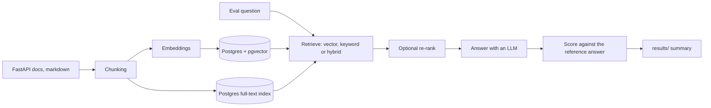

# Architecture

- **Chunking** turns each markdown page into chunks, either fixed-size windows with overlap or one chunk per heading section.
- **Indexing** stores every chunk once, with its embedding (pgvector, HNSW index) and a generated `tsvector` column (GIN index) for keyword search. The embedded text is the chunk's heading path followed by the chunk, so short chunks keep their context.
- **Retrieval** returns the top-k chunks for a question. Hybrid fuses the vector and keyword rankings with reciprocal rank fusion.
- **Re-ranking** optionally re-orders the top candidates with a cross-encoder before they reach the LLM.
- **Evaluation** runs every eval question through one configuration and records whether the right source section was retrieved, whether the answer matches the reference, the latency and the token cost.
